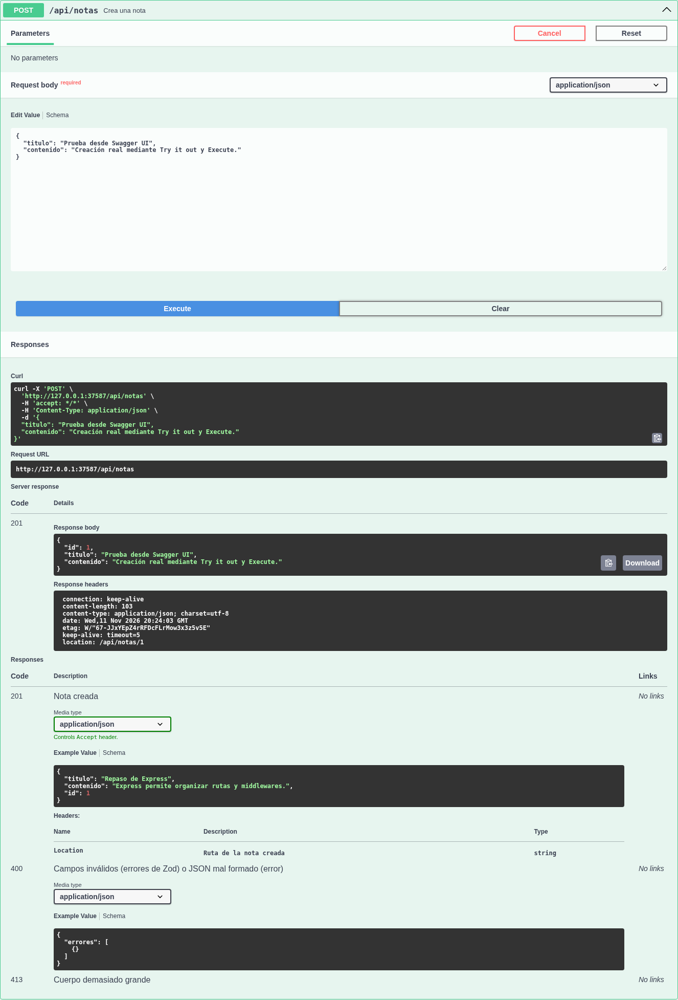
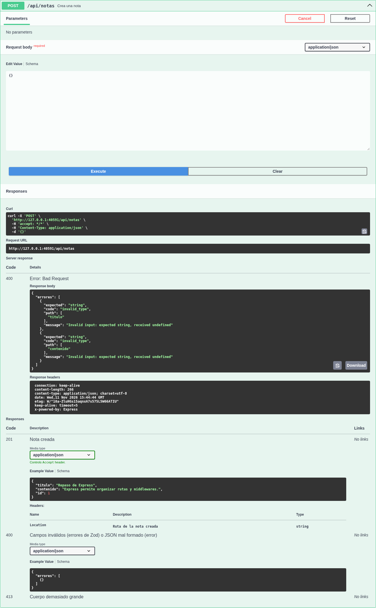

# Laboratorio 5: API REST de notas con Express y Swagger

CRUD de notas del **integrante A (persona 1)**, rama `feature/notas`, e integración con Claude del **integrante B (persona 2)**, rama `feature/ia`.

| Integrante | Nombre | Responsabilidad |
| --- | --- | --- |
| A / persona 1 | Por completar por el estudiante | Express, CRUD, Zod y Swagger |
| B / persona 2 | Por completar por el estudiante | Claude, preguntas, resumen y errores de IA |

## Instalación y ejecución

Requiere Node.js 20 o superior y npm. Desde la raíz del repositorio:

```bash
npm ci
cp .env.example .env
npm run dev
```

Para ejecución sin recarga: `npm start`. Para las pruebas: `npm test`.
Swagger UI está en `http://localhost:3000/api-docs` (o el puerto configurado).
El código está en `lab5-api/src`; los scripts se ejecutan desde la raíz, donde están los manifiestos existentes.
Las notas se guardan en memoria: reiniciar el proceso elimina los datos.

`node_modules` está excluido de Git. Las dependencias se instalan con `npm ci`; no se suben a la rama.

## Variables de entorno

| Variable | Uso |
| --- | --- |
| `PORT` | Puerto del servidor; por defecto 3000; entero entre 0 y 65535 (0 elige un puerto libre) |
| `ANTHROPIC_API_KEY` | Clave privada de la Claude API; solo la lee `claude.service.js`. Sin ella el CRUD y Swagger funcionan y la IA responde 502 |
| `CLAUDE_MODEL` | Modelo usado por `messages.create` (por defecto `claude-haiku-4-5-20251001`) |

`.env.example` no contiene credenciales. Crear `.env` localmente; nunca subirlo ni mostrar claves en capturas. Verificar `git status` antes de cada commit.

## Endpoints implementados

| Método | Ruta | Resultado |
| --- | --- | --- |
| GET | `/api/notas` | 200, arreglo de notas |
| GET | `/api/notas/:id` | 200 con nota; 404 si no existe |
| POST | `/api/notas` | 201 con nota creada y cabecera `Location`; 400 si los datos son inválidos |
| DELETE | `/api/notas/:id` | 204 sin cuerpo; 404 si no existe |
| POST | `/api/ia/preguntar` | 200 con `respuesta` y `uso`; 400 si la pregunta es inválida; 429/502/503 `IA_NO_DISPONIBLE` |
| POST | `/api/notas/:id/resumen` | 200 con `notaId` y `resumen`; 404 sin llamar a Claude; 429/502/503 `IA_NO_DISPONIBLE` |
| GET | `/api-docs` | Documentación interactiva Swagger UI |

Ejemplo de creación:

```bash
curl -i -X POST http://localhost:3000/api/notas \
  -H 'Content-Type: application/json' \
  -d '{"titulo":"Primera nota","contenido":"Texto para resumir después"}'
curl -i http://localhost:3000/api/notas
curl -i http://localhost:3000/api/notas/1
curl -i -X DELETE http://localhost:3000/api/notas/1
```

Los IDs de ruta deben ser enteros positivos escritos en decimal, sin ceros iniciales ni notación científica; los demás devuelven 404.

`titulo`: entre 1 y 100 caracteres; `contenido`: entre 1 y 5000. Se recortan espacios extremos y se descartan propiedades desconocidas. Cuerpo inválido: `{ "errores": [...] }`; nota inexistente: `{ "error": "Nota no encontrada" }`. JSON mal formado devuelve 400; cuerpo excesivo, 413; errores internos, 500 sin detalles sensibles.

## Integración con el integrante B

`src/services/notas.service.js` exporta `listar()`, `crear({ titulo, contenido })`, `buscar(id)` y `eliminar(id)`. `buscar` recibe un número, devuelve una copia de la nota o lanza `AppError(404, 'Nota no encontrada')`. B debe llamar `buscar(Number(req.params.id))` antes de contactar a Claude en la ruta de resumen.

## Integración con Claude (integrante B)

- `src/services/claude.service.js` es el **único** módulo que importa `@anthropic-ai/sdk`. El cliente se crea en la primera pregunta válida (con `timeout` de 30 s y un reintento), de modo que el servidor arranca aunque falte la clave. Usa `messages.create` con `model` desde `CLAUDE_MODEL`, `max_tokens: 1024`, un `system` configurable y devuelve `{ respuesta, uso }`.
- `src/routes/ia.routes.js` implementa `POST /api/ia/preguntar`. Zod exige una pregunta de 3 a 2000 caracteres (tras recortar espacios) **antes** de llamar a Claude.
- `POST /api/notas/:id/resumen` (en `notas.routes.js`) llama primero a `notas.buscar(id)` de A: si la nota no existe responde 404 sin gastar créditos. Envía el contenido como mensaje y la instrucción «Resume el texto en 3 viñetas breves, en español.» como `system`.
- `errorHandler.js` traduce los errores del SDK sin reenviar el mensaje del proveedor; en consola solo se registra estado y tipo:

| Error de Claude | Respuesta de nuestra API |
| --- | --- |
| 401, 400 u otro | 502 `{ "error": "IA_NO_DISPONIBLE" }` |
| 429 | 429 `{ "error": "IA_NO_DISPONIBLE" }` |
| 529 | 503 `{ "error": "IA_NO_DISPONIBLE" }` |
| Conexión o timeout | 502 `{ "error": "IA_NO_DISPONIBLE" }` |

`lab5-api/test/ia.test.js` agrega 7 pruebas con `supertest` que simulan `claude.service`: no consumen créditos ni necesitan clave, y **no sustituyen** las capturas reales con ★.

Swagger usa rutas absolutas de archivos para funcionar independientemente del directorio actual. La definición canónica está en `src/config/swagger.js`; `lab5-api/config/swagger.js` la reexporta para compatibilidad.

## Verificación

`npm test` ejecuta 18 pruebas con `node:test` y peticiones HTTP reales, sin servicios externos ni consumo de créditos:

1. Crear dos notas, listar, consultar, eliminar y comprobar IDs crecientes.
2. Validación de campos, tipos, espacios y límites.
3. Consulta y eliminación de identificadores inexistentes o inválidos.
4. JSON mal formado y ruta desconocida.
5. Swagger UI y validación de la especificación OpenAPI.
6. Contrato `buscar(id)` y protección contra mutaciones externas.

Además cubre IDs ambiguos, cabecera `Location`, cuerpo excesivo, aislamiento de notas, errores internos, arranque desde otro directorio, valores inválidos de `PORT`, puerto ocupado y apagado con SIGTERM.

Resultado de la revisión: **18 aprobadas, 0 fallidas** en Node.js 20.20.2 y 24.22.1. Se verificó una instalación limpia con Node 20; los resultados están en [`docs/evidencias/node20`](docs/evidencias/node20). También se agregó un flujo de GitHub Actions para ejecutar `npm ci`, `npm test` y `npm run test:dev` en Node.js 20 y 24 con cada push a esta rama o pull request hacia `main`; su resultado remoto debe consultarse en la pestaña Actions.

La prueba adicional `npm run test:browser` interactúa con Swagger UI desde Chromium. Para preparar el navegador: `npx playwright install chromium`. Si ya está instalado en Linux: `CHROMIUM_PATH=/usr/bin/chromium npm run test:browser`. Guarda seis capturas reales en [`docs/evidencias`](docs/evidencias) y un registro de resultados. Ver el [informe de revisión](docs/REVISION_PERSONA_1.md).





Pruebas manuales de pareja: B debe repetir el CRUD desde Swagger UI. A debe probar pregunta libre, resumen, nota inexistente, pregunta de una letra y credencial inválida (cambiar `ANTHROPIC_API_KEY` por un valor falso, reiniciar y preguntar: 502 `IA_NO_DISPONIBLE` y `Claude API: 401` en la consola). Las capturas con ★ requieren llamadas reales con clave: guardarlas sin claves en `docs/evidencias/`.

En Windows, la prueba de `servidor.test.js` que detiene el proceso con SIGTERM falla porque Windows no entrega esa señal al proceso; el resto pasa (24 de 25) y en Linux/CI pasan todas.

## Reflexión

1. **¿Por qué la clave no puede estar en el frontend?** El usuario puede inspeccionar JavaScript, mapas de código y solicitudes en las herramientas del navegador. Una clave allí permitiría llamadas no autorizadas y gastos a cargo del propietario. Debe permanecer en el backend y fuera de Git.
2. **¿Qué responder cuando Claude devuelve 401?** Nuestra API responde 502 con `{ "error": "IA_NO_DISPONIBLE" }` (implementado en `errorHandler.js` y cubierto por `ia.test.js`). El 401 significa que la clave **del servidor** fue rechazada por el proveedor, no que el cliente de nuestra API no esté autenticado; reenviarlo confundiría al cliente y podría filtrar detalles internos. El detalle queda solo en la consola del servidor.
3. **`system` frente a `messages`:** `system` define el comportamiento (rol, idioma, formato); `messages` contiene lo que dice el usuario. En el resumen, `system` es «Resume el texto en 3 viñetas breves, en español.» y el mensaje es el contenido de la nota. Experimento real cambiando `system` a «Resume el texto en una frase»: **[completar con lo observado]**.
4. **Tokens y costo:** `max_tokens` limita la salida; validar y limitar la pregunta a 2000 caracteres reduce la entrada. Valores reales (campo `uso` de la respuesta):

| Llamada real | input_tokens | output_tokens |
| --- | --- | --- |
| Pregunta 1 | [completar] | [completar] |
| Pregunta 2 | [completar] | [completar] |
5. **Sin validar antes de Claude:** se gastarían créditos en entradas vacías o demasiado largas y podrían enviarse tipos o parámetros inválidos, causando errores y latencia innecesaria.
6. **Conflictos de Git:** `feature/ia` se creó desde `main` ya con el CRUD de A, por lo que no hubo conflicto textual. Sí hubo una diferencia de contrato: la versión inicial de B devolvía 400 para ids no numéricos en el resumen, pero A ya validaba `:id` con `router.param` y responde 404; B adaptó su ruta y sus pruebas al comportamiento de A en lugar de duplicar la validación. También se corrigió la ruta `apis` de `swagger.js`, que en Windows dejaba Swagger UI sin endpoints.

## Modo desarrollo y exposición

`npm run test:dev` comprueba en Linux/macOS/WSL el arranque mediante `npm run dev`, la creación de una nota y la recarga de nodemon al crear un archivo temporal. Después verifica que las notas se reiniciaron y Swagger sigue respondiendo. Cierra los procesos y elimina el archivo temporal; guarda el resultado en `docs/evidencias/desarrollo.json`. Utiliza un puerto libre y no necesita Claude.

Para preparar tu explicación, consulta la [guía de exposición de A](docs/GUIA_EXPOSICION_PERSONA_A.md), con recorrido del código, demostración y preguntas posibles. El [contenido del pull request y la lista para revisión de B](docs/PR_PERSONA_A.md) están preparados para usarse en GitHub.

## Colaboración y entrega

Los cambios de A se publican en `feature/notas`, sin modificar `main`. Abrir un pull request hacia `main` para revisión de B; el compañero debe dejar sus propios comentarios y aprobarlo antes de fusionar. No se simulan aprobaciones ni se atribuyen commits a otras personas. Completar los nombres, pruebas de IA, capturas, métricas y reflexión de integración antes de la entrega final conjunta.
